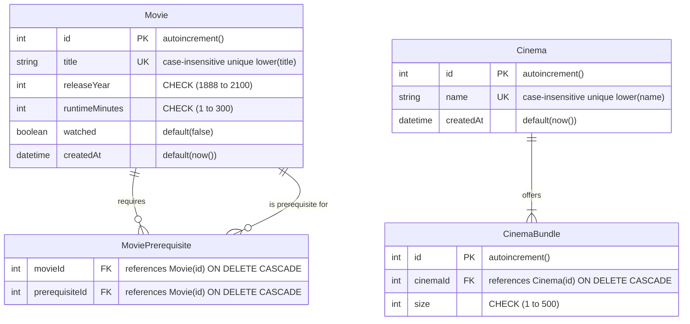

# Doomsday Ready: MCU Watch-Party Platform

> A full-stack web application designed for Marvel fans ahead of *Avengers: Doomsday*. Features hand-written graph and dynamic programming algorithms, PostgreSQL `Serializable` transactions, and a Next.js 14.2 + Redux Toolkit interface.

---

## Table of Contents
1. [Architecture Overview](#1-architecture-overview)
2. [Quick Start (Docker Compose)](#2-quick-start-docker-compose)
3. [Local Development Setup](#3-local-development-setup)
4. [Database Model & Entity Relationship Diagram](#4-database-model--entity-relationship-diagram)
5. [Complete REST API Reference](#5-complete-rest-api-reference)
6. [Core Hand-Written Algorithm Engines](#6-core-hand-written-algorithm-engines)
   - [Feature 1: Prerequisite Cycle Detection & Rewatch Sequence (Graph Algorithms)](#feature-1-prerequisite-cycle-detection--rewatch-sequence)
   - [Feature 2: Watch-Party Bundle Optimization (Dynamic Programming)](#feature-2-watch-party-bundle-optimization)
7. [Documented Domain Assumptions](#7-documented-domain-assumptions)
8. [Automated Testing & Verification](#8-automated-testing--verification)
9. [AI Collaboration & Technical Review Log](#9-ai-collaboration--technical-review-log)

---

## 1. Architecture Overview

- **Backend API**: Node.js / Express with TypeScript (`module: NodeNext`).
- **Database & ORM**: PostgreSQL 16 Alpine with Prisma 6 (`prisma@^6.4.1`, `@prisma/client@^6.4.1`). Relational foreign keys, check constraints, and case-insensitive unique indexes on `LOWER(title)` and `LOWER(name)`.
- **Concurrency & Integrity**: Prerequisite updates run in `Serializable` transaction isolation with automated exponential backoff retry on `P2034` serialization conflicts. Cycle detection is computed *before* persisting any write to prevent invalid dependency graphs.
- **Frontend Application**: Next.js 14.2 (`next@14.2.24`, App Router) with React 18, TypeScript, Tailwind CSS, and Redux Toolkit with optimistic updates and automatic rollbacks.
- **Pure Algorithms**: Zero external libraries for graph traversal, cycle detection, or coin-change optimization.

---

## 2. Quick Start (Docker Compose)

Run the entire platform (PostgreSQL database, Node.js backend, and Next.js frontend) with a single command:

```bash
docker compose up --build
```

### Access Endpoints
- **Frontend Application**: [http://localhost:3000](http://localhost:3000)
- **Backend API**: [http://localhost:3001/api/movies](http://localhost:3001/api/movies)
- **Database**: PostgreSQL runs internally on `doomsday-net` (not exposed to the host network in production compose).

### Clean Teardown
```bash
docker compose down -v
```

---

## 3. Local Development Setup

### Prerequisites
- Node.js `v20.x` or `v22.x`
- `pnpm`
- Docker & Docker Compose (for local PostgreSQL instance)

### 3.1 Start Local PostgreSQL Databases
Launch the local PostgreSQL service on port `5433`:

```bash
docker compose -f docker-compose.dev.yml up -d
```

#### How the databases are created
The `docker-compose.dev.yml` file configures `POSTGRES_DB: doomsday_dev`, which causes PostgreSQL to create the `doomsday_dev` database on initial container startup. It also mounts `./docker/init-test-db.sh` into `/docker-entrypoint-initdb.d/init-test-db.sh`. On initialization, this shell script runs a SQL statement that creates the `doomsday_test` database if it does not already exist:

```sql
SELECT 'CREATE DATABASE doomsday_test'
WHERE NOT EXISTS (SELECT FROM pg_database WHERE datname = 'doomsday_test')\gexec
```

Both databases run on the same PostgreSQL instance (`127.0.0.1:5433`), allowing `doomsday_dev` to be used for active development and `doomsday_test` to be used for automated integration tests without cross-contamination.

### 3.2 Backend Setup
```bash
cd backend

# 1. Install dependencies
pnpm install

# 2. Deploy Prisma migrations and SQL constraints
npx prisma migrate deploy

# 3. Seed the 8 MCU movies and 4 cinema venues
pnpm run seed

# 4. Start backend dev server (port 3001)
pnpm run dev
```

### 3.3 Frontend Setup
```bash
cd frontend

# 1. Install dependencies
pnpm install

# 2. Start frontend dev server (port 3000)
pnpm run dev
```

The Next.js frontend proxies `/api/*` requests to `http://localhost:3001` via rewrites configured in `next.config.mjs`.

---

## 4. Database Model & Entity Relationship Diagram

### 4.1 Mermaid ER Diagram



### 4.2 SQL Constraints & Indexing Strategy
- **Composite Primary Key**: `movie_prerequisites` enforces `PRIMARY KEY ("movieId", "prerequisiteId")`.
- **Self-Dependency Check Constraint**: `CHECK ("movie_id" != "prerequisite_id")` prevents a movie from referencing itself directly.
- **Reverse Lookup Index**: `CREATE INDEX "idx_prerequisites_prereq_id"` on `movie_prerequisites("prerequisiteId")` accelerates reverse prerequisite lookups.
- **Case-Insensitive Uniqueness**: `CREATE UNIQUE INDEX "idx_movies_unique_lower_title" ON "movies" (LOWER("title"))` and `LOWER("name")` on cinemas prevent case duplicates like `"iron man"` and `"Iron Man"`.

---

## 5. Complete REST API Reference

All requests and responses use JSON. Payloads accept both `camelCase` and `snake_case` input keys; responses are formatted in `camelCase`.

### Error Protocol
All error responses adhere to:
```json
{
  "error": "ERROR_CODE",
  "message": "Human-readable explanation"
}
```

Common status codes:
- `400 VALIDATION_ERROR`: Missing fields, non-integer IDs, duplicate bundle sizes, invalid group size ($< 1$ or $> 10000$), unknown prerequisite IDs.
- `404 NOT_FOUND`: Target entity ID does not exist.
- `409 CIRCULAR_DEPENDENCY`: Proposed prerequisite graph introduces a cycle.
- `409 DUPLICATE_TITLE`: A movie with this title already exists.
- `409 DUPLICATE_NAME`: A cinema with this name already exists.

---

### 5.1 Movie Endpoints

#### List Movies
```bash
curl -X GET http://localhost:3001/api/movies
```
**Response (`200 OK`)**:
```json
[
  {
    "id": 1,
    "title": "Iron Man",
    "releaseYear": 2008,
    "runtimeMinutes": 126,
    "watched": false,
    "prerequisites": []
  },
  {
    "id": 2,
    "title": "Captain America: The First Avenger",
    "releaseYear": 2011,
    "runtimeMinutes": 124,
    "watched": false,
    "prerequisites": []
  },
  {
    "id": 3,
    "title": "The Avengers",
    "releaseYear": 2012,
    "runtimeMinutes": 143,
    "watched": false,
    "prerequisites": [
      {
        "id": 1,
        "title": "Iron Man",
        "releaseYear": 2008,
        "runtimeMinutes": 126,
        "watched": false
      },
      {
        "id": 2,
        "title": "Captain America: The First Avenger",
        "releaseYear": 2011,
        "runtimeMinutes": 124,
        "watched": false
      }
    ]
  },
  {
    "id": 4,
    "title": "Captain America: Civil War",
    "releaseYear": 2016,
    "runtimeMinutes": 147,
    "watched": false,
    "prerequisites": [
      {
        "id": 3,
        "title": "The Avengers",
        "releaseYear": 2012,
        "runtimeMinutes": 143,
        "watched": false
      }
    ]
  },
  {
    "id": 5,
    "title": "Thor: Ragnarok",
    "releaseYear": 2017,
    "runtimeMinutes": 130,
    "watched": false,
    "prerequisites": []
  },
  {
    "id": 6,
    "title": "Avengers: Infinity War",
    "releaseYear": 2018,
    "runtimeMinutes": 149,
    "watched": false,
    "prerequisites": [
      {
        "id": 4,
        "title": "Captain America: Civil War",
        "releaseYear": 2016,
        "runtimeMinutes": 147,
        "watched": false
      },
      {
        "id": 5,
        "title": "Thor: Ragnarok",
        "releaseYear": 2017,
        "runtimeMinutes": 130,
        "watched": false
      }
    ]
  },
  {
    "id": 7,
    "title": "Avengers: Endgame",
    "releaseYear": 2019,
    "runtimeMinutes": 181,
    "watched": false,
    "prerequisites": [
      {
        "id": 6,
        "title": "Avengers: Infinity War",
        "releaseYear": 2018,
        "runtimeMinutes": 149,
        "watched": false
      }
    ]
  },
  {
    "id": 8,
    "title": "Avengers: Doomsday",
    "releaseYear": 2026,
    "runtimeMinutes": 180,
    "watched": false,
    "prerequisites": [
      {
        "id": 7,
        "title": "Avengers: Endgame",
        "releaseYear": 2019,
        "runtimeMinutes": 181,
        "watched": false
      }
    ]
  }
]
```

#### Create Movie
```bash
curl -X POST http://localhost:3001/api/movies \
  -H "Content-Type: application/json" \
  -d '{
    "title": "Doctor Strange",
    "releaseYear": 2016,
    "runtimeMinutes": 115,
    "prerequisites": [1]
  }'
```
**Response (`201 Created`)**:
```json
{
  "id": 9,
  "title": "Doctor Strange",
  "releaseYear": 2016,
  "runtimeMinutes": 115,
  "watched": false,
  "prerequisites": [
    {
      "id": 1,
      "title": "Iron Man",
      "releaseYear": 2008,
      "runtimeMinutes": 126,
      "watched": false
    }
  ]
}
```

#### Update Movie (Watched Status / Prerequisites)
```bash
# Update watched status
curl -X PATCH http://localhost:3001/api/movies/1 \
  -H "Content-Type: application/json" \
  -d '{ "watched": true }'

# Atomically replace prerequisites (or pass [] to clear)
curl -X PATCH http://localhost:3001/api/movies/4 \
  -H "Content-Type: application/json" \
  -d '{ "prerequisites": [1, 2, 3] }'
```
**Response (`200 OK`)**:
```json
{
  "id": 4,
  "title": "Captain America: Civil War",
  "releaseYear": 2016,
  "runtimeMinutes": 147,
  "watched": false,
  "prerequisites": [
    {
      "id": 1,
      "title": "Iron Man",
      "releaseYear": 2008,
      "runtimeMinutes": 126,
      "watched": true
    },
    {
      "id": 2,
      "title": "Captain America: The First Avenger",
      "releaseYear": 2011,
      "runtimeMinutes": 124,
      "watched": false
    },
    {
      "id": 3,
      "title": "The Avengers",
      "releaseYear": 2012,
      "runtimeMinutes": 143,
      "watched": false
    }
  ]
}
```

#### Circular Dependency Error Example
```bash
# Attempt to make Endgame (7) a prerequisite of Iron Man (1)
curl -X PATCH http://localhost:3001/api/movies/1 \
  -H "Content-Type: application/json" \
  -d '{ "prerequisites": [7] }'
```
**Response (`409 Conflict`)**:
```json
{
  "error": "CIRCULAR_DEPENDENCY",
  "message": "The requested prerequisites would create a circular dependency"
}
```

#### Get Topological Rewatch Order
```bash
curl -X GET http://localhost:3001/api/movies/8/rewatch-order
```
**Response (`200 OK`)**:
```json
{
  "target": {
    "id": 8,
    "title": "Avengers: Doomsday",
    "releaseYear": 2026,
    "runtimeMinutes": 180,
    "watched": false,
    "prerequisites": [
      {
        "id": 7,
        "title": "Avengers: Endgame",
        "releaseYear": 2019,
        "runtimeMinutes": 181,
        "watched": false
      }
    ]
  },
  "order": [
    {
      "id": 1,
      "title": "Iron Man",
      "runtimeMinutes": 126,
      "watched": false
    },
    {
      "id": 2,
      "title": "Captain America: The First Avenger",
      "runtimeMinutes": 124,
      "watched": false
    },
    {
      "id": 3,
      "title": "The Avengers",
      "runtimeMinutes": 143,
      "watched": false
    },
    {
      "id": 4,
      "title": "Captain America: Civil War",
      "runtimeMinutes": 147,
      "watched": false
    },
    {
      "id": 5,
      "title": "Thor: Ragnarok",
      "runtimeMinutes": 130,
      "watched": false
    },
    {
      "id": 6,
      "title": "Avengers: Infinity War",
      "runtimeMinutes": 149,
      "watched": false
    },
    {
      "id": 7,
      "title": "Avengers: Endgame",
      "runtimeMinutes": 181,
      "watched": false
    }
  ],
  "watchedCount": 0,
  "totalCount": 7,
  "remainingRuntimeMinutes": 1000
}
```

---

### 5.2 Cinema & Booking Endpoints

#### List Cinemas
```bash
curl -X GET http://localhost:3001/api/cinemas
```
**Response (`200 OK`)**:
```json
[
  {
    "id": 1,
    "name": "Stark IMAX",
    "bundleSizes": [6, 9, 20]
  },
  {
    "id": 2,
    "name": "Avengers Megaplex",
    "bundleSizes": [1, 3, 4]
  },
  {
    "id": 3,
    "name": "Wakanda Royal Cinema",
    "bundleSizes": [2, 5]
  },
  {
    "id": 4,
    "name": "Retro Cinema 4-6",
    "bundleSizes": [4, 6]
  }
]
```

#### Create Cinema
```bash
curl -X POST http://localhost:3001/api/cinemas \
  -H "Content-Type: application/json" \
  -d '{
    "name": "Sanctum Sanctorum Cinema",
    "bundleSizes": [5, 10, 25]
  }'
```
**Response (`201 Created`)**:
```json
{
  "id": 5,
  "name": "Sanctum Sanctorum Cinema",
  "bundleSizes": [5, 10, 25]
}
```

#### Calculate Watch-Party Quote (Dynamic Programming)
```bash
# Stark IMAX (id: 1, bundle sizes: [6, 9, 20]) with group size 44
curl -X GET "http://localhost:3001/api/cinemas/1/booking?groupSize=44"
```
**Response (`200 OK`)**:
```json
{
  "cinema": {
    "id": 1,
    "name": "Stark IMAX",
    "bundleSizes": [6, 9, 20]
  },
  "groupSize": 44,
  "possible": true,
  "totalBundles": 4,
  "breakdown": [
    { "size": 20, "count": 1 },
    { "size": 9, "count": 2 },
    { "size": 6, "count": 1 }
  ]
}
```

#### Impossible Combination Example
```bash
# Retro Cinema 4-6 (id: 4, bundle sizes: [4, 6]) with group size 7
curl -X GET "http://localhost:3001/api/cinemas/4/booking?groupSize=7"
```
**Response (`200 OK`)**:
```json
{
  "cinema": {
    "id": 4,
    "name": "Retro Cinema 4-6",
    "bundleSizes": [4, 6]
  },
  "groupSize": 7,
  "possible": false,
  "message": "No exact combination"
}
```

---

## 6. Core Hand-Written Algorithm Engines

### Feature 1: Prerequisite Cycle Detection & Rewatch Sequence
*Implemented in `backend/src/services/graphService.ts` as pure TypeScript functions with no database or ORM dependencies.*

#### 1. Cycle Detection: 3-Color Directed Depth-First Search (`hasCycle`)
Proposed prerequisite changes are checked in memory before writing to the database.
- **States**:
  - `0 (UNVISITED)`: Node has not yet been processed.
  - `1 (VISITING)`: Node is currently on the active recursion call stack. Encountering a node in state `1` confirms a back-edge and therefore a cycle.
  - `2 (VISITED)`: Node and all of its descendants have been fully explored.
- **Direct Check**: Identifies direct self-reference immediately (`proposedPrereqs.includes(movieId)`).
- **Hypothetical Graph**: Clones the existing adjacency list in memory, applies the proposed edges for `movieId`, and runs DFS from `movieId`.
- **Complexity**:
  - **Time Complexity**: $O(V + E)$, where $V$ is the number of movies and $E$ is the number of prerequisite edges.
  - **Space Complexity**: $O(V)$ for the recursion stack and visited color map.

#### 2. Topological Rewatch Sequence (`computeRewatchOrder`)
Determines the required viewing order to reach a target movie.
- **Traversal**: Uses DFS post-order traversal (`dfs(child)` then append `child`).
- **Diamond Dependency Deduplication**: A global `visited` Set ensures diamond dependencies (e.g., *Iron Man* being required by both *The Avengers* and *Civil War*) are included exactly once in the resulting list.
- **Target Exclusion**: The target movie itself is excluded from the prerequisite checklist.
- **Metrics**: Calculates `watchedCount`, `totalCount`, and sums `remainingRuntimeMinutes` across unwatched prerequisites.
- **Complexity**:
  - **Time Complexity**: $O(V + E)$ where each reachable movie and prerequisite is traversed once.
  - **Space Complexity**: $O(V)$ for the visited set, recursion stack, and output sequence.

---

### Feature 2: Watch-Party Bundle Optimization
*Implemented in `backend/src/services/bookingService.ts` as pure TypeScript functions with no database or ORM dependencies.*

#### Unbounded Coin-Change Dynamic Programming (`calculateBookingQuote`)
Given a cinema's available bundle sizes and a target group size $N \in [1, 10000]$, the algorithm determines the combination of bundle sizes that seats **exactly** $N$ guests with **zero empty seats** while **minimizing the total number of bundles purchased**.

#### DP Recurrence Formulation
Let $dp[i]$ denote the minimum number of bundles required to seat $i$ people:
$$dp[0] = 0$$
$$dp[i] = \min_{s \in S, s \le i} \left( dp[i - s] + 1 \right)$$
where $S$ is the set of available positive bundle sizes, and $choice[i] = s$ stores the bundle size chosen to achieve that minimum.

#### Tie-Breaking Rule & Determinism
Bundle sizes are sorted in ascending order. When updating the DP table:
```typescript
if (candidateCount < dp[i]) {
  dp[i] = candidateCount;
  choice[i] = size;
}
```
The strict inequality (`<`) ensures that if multiple combinations yield the identical minimum bundle count, earlier valid solutions are preserved deterministically.

#### Backtracking Reconstruction
Starting from $i = N$, the choice array is traced back ($i \leftarrow i - choice[i]$) until $i = 0$. Counts of each bundle size are aggregated and sorted in **descending size order** ($20 \times 1, 9 \times 2, 6 \times 1$) so organizers receive the largest bundle blocks first.

#### Complexity
- **Time Complexity**: $O(N \cdot B)$, where $N \le 10,000$ is the group size and $B \le 10$ is the number of bundle sizes.
- **Space Complexity**: $O(N)$ for the `dp` and `choice` arrays.

---

## 7. Documented Domain Assumptions

1. **Release Year Limits**: Movie release years are constrained between `1888` (the earliest recorded motion picture) and `2100` via database `CHECK` constraints and Zod validation schemas.
2. **Runtime Limits**: Runtimes must be positive integers between `1` and `300` minutes.
3. **Bundle Limits**: Cinema bundle sizes must be positive integers between `1` and `500`. A cinema must offer between 1 and 10 unique bundle sizes.
4. **Group Size Limits**: Watch-party queries validate integer group sizes between `1` and `10,000`.
5. **Case-Insensitive Uniqueness**: Movie titles and cinema names are enforced as case-insensitively unique via PostgreSQL unique indexes (`LOWER(title)` and `LOWER(name)`).
6. **Input Normalization**: Both `camelCase` and `snake_case` JSON input keys (`release_year` / `releaseYear`, `bundle_sizes` / `bundleSizes`, `group_size` / `groupSize`) are accepted; API output format is strictly `camelCase`.
7. **Prerequisite Replacement & Empty List**: Patching `prerequisites` atomically replaces the entire prerequisite set. Passing `prerequisites: []` explicitly clears all prerequisites without triggering an "empty body" 400 error.
8. **Unknown Prerequisite Handling**: If any ID in a requested prerequisite array does not exist in the database, the API returns `400 VALIDATION_ERROR` with the missing IDs.
9. **Serializable Concurrency Conflict Retry**: Under concurrent writes, PostgreSQL `Serializable` transactions may emit error `P2034` (serialization failure). The transaction helper catches `P2034` specifically and retries up to 3 times with exponential backoff before throwing an error.

---

## 8. Automated Testing & Verification

The test suite covers pure algorithms and HTTP API endpoints using Vitest and Supertest against an isolated PostgreSQL test database (`doomsday_test`).

### Running Backend Tests
```bash
cd backend

# Execute unit and integration tests
pnpm test
```

### Test Coverage
- **Rewatch Scenario 1**: *Avengers: Doomsday* requires all 7 MCU predecessors in valid topological order.
- **Rewatch Scenario 2**: *Captain America: Civil War* returns *Iron Man*, *The First Avenger*, and *The Avengers*.
- **Rewatch Scenario 3**: *Thor: Ragnarok* returns an empty sequence `[]` (direct watch).
- **Rewatch Scenario 4**: Adding *Endgame* as a prerequisite of *Iron Man* triggers a `409 CIRCULAR_DEPENDENCY`.
- **Booking Scenario 1**: `{1, 3, 4}` for 6 guests $\to$ 2 bundles ($3 \times 2$).
- **Booking Scenario 2**: `{2, 5}` for 11 guests $\to$ 4 bundles ($5 \times 1, 2 \times 3$).
- **Booking Scenario 3**: `{6, 9, 20}` for 44 guests $\to$ 4 bundles ($20 \times 1, 9 \times 2, 6 \times 1$).
- **Booking Scenario 4**: `{4, 6}` for 7 guests $\to$ impossible notice.

---

## AI Usage
I used an AI assistant to help draft the project plan and task breakdown.
All code in this repository was written by me.

